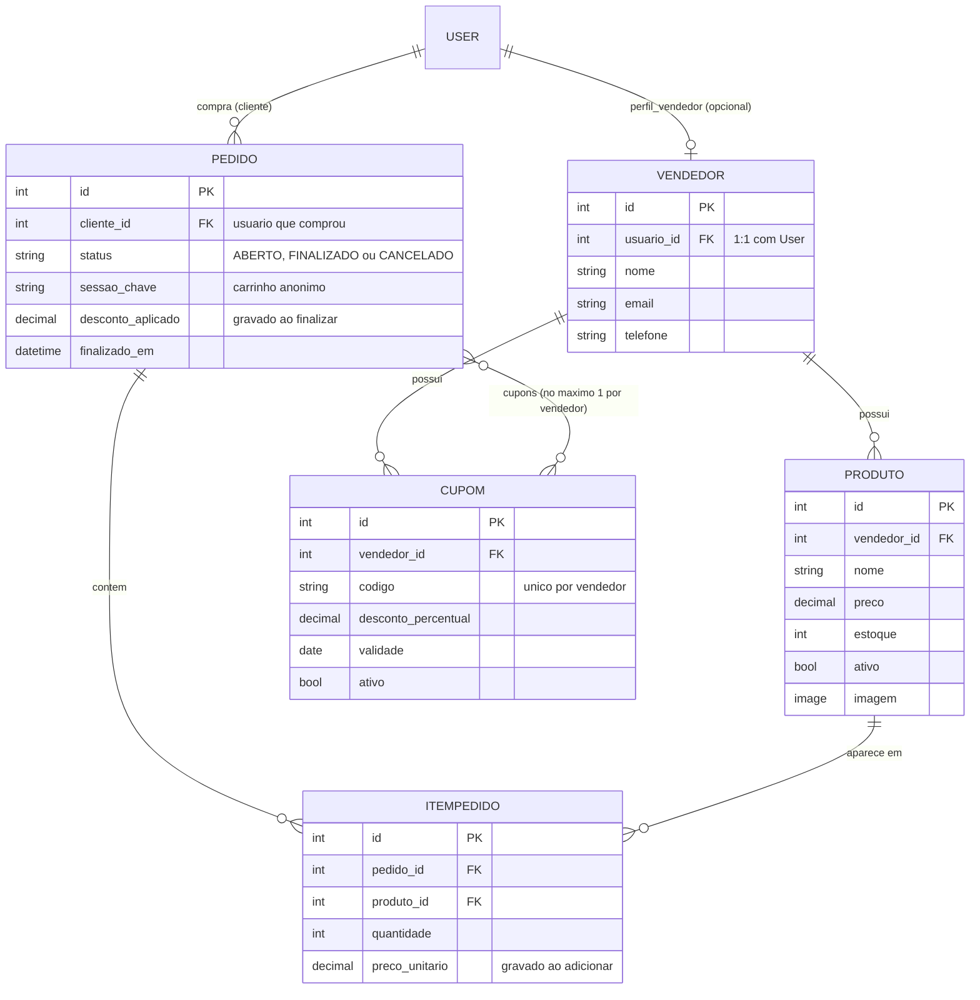

# Mini E-commerce — P2 (mini-SaaS multi-organização)

Projeto da disciplina de **Laboratório de Programação Full Stack** (Engenharia de Software, Univassouras), feito em Django, PostgreSQL e Docker.

Na **P1** o projeto era um e-commerce simples: vitrine de produtos, carrinho com cálculo de total, cupom de desconto e baixa de estoque ao finalizar o pedido. Na **P2** ele evolui para um **mini-SaaS**: cada vendedor administra a própria loja (produtos, cupons e pedidos recebidos), cada cliente enxerga só os próprios pedidos e tudo isso também é exposto por uma **API REST** (Django REST Framework).

O que mudou da P1 para a P2:

- **Perfis**: contas de *cliente* e de *vendedor*, com áreas separadas.
- **Multi-organização**: cada vendedor é uma "organização" e os dados de um vendedor nunca aparecem para outro (veja [Multi-organização](#multi-organização-cada-vendedor-é-uma-organização)).
- **Pedidos com dono**: o pedido pertence ao usuário que comprou; existem as telas *Meus pedidos* (cliente) e *Pedidos recebidos* (vendedor).
- **Cupom do vendedor**: o cupom pertence a um vendedor e só desconta os produtos dele; um pedido pode ter vários cupons (um por vendedor).
- **Estoque protegido**: a quantidade acumulada no carrinho é validada e a baixa de estoque é atômica.
- **Carrinho preservado no login**: o carrinho montado antes de entrar passa para a conta.
- **API REST** em `/api/` para produtos, cupons e pedidos.
- **Dashboard**: veja a seção [Dashboard](#dashboard).

O histórico das correções feitas na P1 está em [`MELHORIAS-P1.md`](MELHORIAS-P1.md).

## Stack

- Python 3.12 e **Django 5**
- **PostgreSQL 16**
- **Django REST Framework** (API com autenticação por sessão)
- **Gunicorn** (servidor da aplicação) e **WhiteNoise** (arquivos estáticos)
- **Docker** e Docker Compose (dois serviços: `db` e `web`)
- Bootstrap e um pouco de JavaScript nos templates

## Como rodar com Docker

O `docker-compose.yml` sobe dois containers:

- **db**: PostgreSQL, com `healthcheck` via `pg_isready`.
- **web**: o Django servido pelo Gunicorn, com `healthcheck` em `/healthz/`, que faz um `SELECT 1` no banco. O `web` só sobe depois que o `db` estiver saudável.

Ao iniciar, o `entrypoint.sh` espera o Postgres responder, roda `makemigrations`, `migrate` e `collectstatic` e então inicia o Gunicorn.

### Passo a passo

1. Crie o seu `.env` a partir do modelo. **O `.env` não vem no repositório** (ele está no `.gitignore`, porque guarda senhas e a `SECRET_KEY`), então este passo é obrigatório:
   ```bash
   cp .env.example .env
   ```
   No Windows (PowerShell): `Copy-Item .env.example .env`. Depois ajuste os valores se quiser (veja a tabela abaixo).

2. Suba os containers:
   ```bash
   docker compose up --build
   ```

3. Confira a saúde dos serviços (a coluna `STATUS` deve mostrar `healthy` nos dois):
   ```bash
   docker compose ps
   ```

4. Crie um superusuário para entrar no `/admin/` (com o container `web` rodando):
   ```bash
   docker compose exec web python manage.py createsuperuser
   ```

5. Para parar os containers:
   ```bash
   docker compose down
   ```

### Variáveis do `.env`

| Variável | Para que serve |
|---|---|
| `SECRET_KEY` | Chave secreta do Django. Troque por uma chave aleatória. |
| `DEBUG` | `True` ou `False`. Com `False` o Django **não serve as imagens enviadas** dos produtos (o `config/urls.py` só serve mídia com `DEBUG=True`). Para testar upload de imagem, use `DEBUG=True`. |
| `ALLOWED_HOSTS` | Hosts aceitos, separados por vírgula. |
| `DATABASE_NAME`, `DATABASE_USER`, `DATABASE_PASSWORD` | Banco, usuário e senha do Postgres (o compose usa os mesmos valores para criar o banco). |

### URLs úteis

| URL | O que é |
|---|---|
| http://localhost:8000/ | Vitrine da loja |
| http://localhost:8000/cadastro/ | Cadastro (escolha *Cliente* ou *Vendedor*) |
| http://localhost:8000/entrar/ | Login |
| http://localhost:8000/admin/ | Painel administrativo do Django |
| http://localhost:8000/healthz/ | Healthcheck (usado pelo Docker) |
| http://localhost:8000/api/produtos/ | API (Browsable API do DRF) |
| http://localhost:8000/api-auth/login/ | Login da Browsable API |

### Atenção: as migrations não são versionadas

As migrations **não** ficam no Git: o `entrypoint.sh` roda `makemigrations` + `migrate` a cada subida do container. Por isso, **depois de mudar qualquer model**, apague o banco antes de subir de novo, senão o banco antigo fica diferente dos models:

```bash
docker compose down -v      # o -v apaga o volume do Postgres (todos os dados!)
docker compose up --build
```

Os models novos são sempre criados com `null=True` ou `default` para que a migration gerada no container não peça valor para linhas existentes.

### Como rodar sem Docker (opcional)

Precisa de um PostgreSQL rodando na sua máquina. Com o ambiente virtual ativo:

```bash
pip install -r requirements.txt
# variáveis de conexão (DATABASE_HOST já assume "localhost" por padrão)
export DATABASE_NAME=ecommerce DATABASE_USER=ecommerce DATABASE_PASSWORD=ecommerce
python manage.py makemigrations
python manage.py migrate
python manage.py createsuperuser
python manage.py runserver
```

## Estrutura de pastas

```
.
├── config/                  -> configurações do Django
│   ├── settings.py          -> apps, banco (Postgres), DRF com autenticação por sessão, WhiteNoise
│   └── urls.py              -> rotas raiz: /admin/, /healthz/, /api/, /api-auth/ e o app loja
├── loja/                    -> app único do projeto
│   ├── models.py            -> Vendedor, Produto, Cupom, Pedido e ItemPedido (regras de negócio)
│   ├── cart.py              -> classe Carrinho (Pedido ABERTO) e união do carrinho anônimo no login
│   ├── decorators.py        -> @vendedor_required e vendedor_atual(request)
│   ├── validators.py        -> regras de cupom compartilhadas entre formulário e API
│   ├── forms.py             -> formulários (cadastro, login, produto, cupom, carrinho, checkout)
│   ├── views.py             -> views HTML: vitrine, carrinho, checkout, área do cliente e do vendedor
│   ├── urls.py              -> rotas do site (namespace "loja:")
│   ├── api_views.py         -> views da API REST (generics do DRF)
│   ├── api_urls.py          -> rotas da API (namespace "api:")
│   ├── serializers.py       -> serializers de produto, cupom e pedido
│   ├── permissions.py       -> IsVendedor (API exclusiva de vendedor)
│   ├── health.py            -> view do healthcheck
│   ├── health_urls.py       -> rota /healthz/ (sem namespace)
│   ├── admin.py             -> registro dos models no /admin/
│   ├── migrations/          -> só o __init__.py: as migrations são geradas no container
│   ├── templates/loja/      -> HTML (base, vitrine, carrinho, checkout, telas do cliente e do vendedor)
│   └── static/loja/         -> CSS e JavaScript
├── Dockerfile               -> imagem do container "web" (Django + Gunicorn)
├── entrypoint.sh            -> espera o banco, migra, coleta estáticos e sobe o Gunicorn
├── docker-compose.yml       -> serviços "db" (Postgres) e "web" (Django), com healthcheck
├── .env.example             -> modelo de variáveis de ambiente (copie para .env)
├── MELHORIAS-P1.md          -> correções feitas na P1 e acompanhamento
├── manage.py
└── requirements.txt
```

## Modelo de dados



O `Vendedor` é o perfil de uma conta (`user.perfil_vendedor`); quem se cadastra como *Vendedor* ganha esse registro automaticamente. Quem não tem `Vendedor` é cliente.

### Regras de negócio

**Carrinho e pedido.** O carrinho é um `Pedido` com status `ABERTO`. Visitante anônimo tem o carrinho preso à sessão; usuário logado tem o carrinho ligado à conta. Ao entrar ou se cadastrar, o carrinho anônimo é levado para a conta (se a conta já tinha carrinho, os itens são somados sem passar do estoque). O checkout exige login e o pedido passa a pertencer ao usuário logado.

**Estoque.**
- Ao adicionar ao carrinho, a quantidade **acumulada** (o que já estava no carrinho mais o novo) não pode passar do estoque. Na tela do carrinho, a nova quantidade também é comparada com o estoque.
- A baixa acontece em `Pedido.finalizar()`, dentro de `transaction.atomic()` e com `select_for_update()` no pedido e nos produtos, para que duas compras simultâneas não levem o estoque abaixo de zero. Se algum item não tiver estoque, nada é baixado e a pessoa volta ao carrinho com a mensagem de erro.
- O `preco_unitario` do item é copiado do produto quando ele é adicionado ao carrinho.
- Um produto que já consta em algum pedido ou carrinho não pode ser excluído (`ItemPedido.produto` é `PROTECT`): desative-o com `ativo = false`.

**Cupons por vendedor.**
- Todo cupom pertence a um vendedor, que vem do usuário logado (nunca de formulário ou URL).
- O código é único **por vendedor** (`UniqueConstraint` em `vendedor` + `codigo`), sem diferenciar maiúsculas de minúsculas, e é guardado em maiúsculas. A checagem acontece no `clean` do formulário e na validação do serializer, com a mesma regra (`loja/validators.py`).
- O desconto é um percentual de 0,01 a 100. A validade não pode estar no passado ao criar o cupom ou ao alterá-la. Um cupom só vale se estiver ativo e dentro da validade.
- O cupom desconta **apenas os itens do vendedor dono do cupom**, mesmo que o carrinho misture produtos de vendedores diferentes.

**Vários cupons por pedido.**
- O pedido aceita um cupom por vendedor (`Pedido.cupons`). Se vários vendedores do carrinho tiverem o mesmo código, todos são aplicados, cada um sobre os itens do seu vendedor.
- Só entram cupons de vendedores que têm produto no carrinho. Aplicar um cupom novo substitui o que o mesmo vendedor já tinha no pedido.

**Desconto gravado na finalização.** Ao finalizar, o desconto total é gravado em `Pedido.desconto_aplicado`. Pedido finalizado mostra sempre esse valor, então editar ou desativar um cupom depois não muda o total de pedidos antigos. O total é `subtotal - desconto`, nunca abaixo de zero.

## Perfis

| Perfil | O que acessa |
|---|---|
| **Visitante** (sem login) | Vitrine, carrinho, login e cadastro. Ao tentar finalizar a compra, é levado ao login. |
| **Cliente** | Tudo do visitante, mais: checkout (`/finalizar/`), confirmação do pedido, **Meus pedidos** (`/pedidos/`) e detalhe de cada pedido. Na API, vê os próprios pedidos em `/api/pedidos/`. |
| **Vendedor** | Tudo do cliente (ele também pode comprar), mais a **área do vendedor**: Meus produtos, Meus cupons e Pedidos recebidos (`/vendedor/...`). Na API, usa `/api/produtos/`, `/api/cupons/` e `/api/pedidos/`. |
| **Administrador** (superusuário) | Painel `/admin/` do Django. |

Quem não é vendedor e abre uma rota `/vendedor/...` é redirecionado para a vitrine com uma mensagem de erro. Quem não está logado é redirecionado para o login.

## Multi-organização: cada vendedor é uma "organização"

Nos slides da disciplina o multi-tenant é feito com um model `Organizacao` e um `Perfil`. Neste projeto, por **decisão acordada com o professor**, os vendedores fazem o papel de organização: o `Vendedor` é o "dono" dos dados, e por isso **não existem** os models `Organizacao` nem `Perfil`.

Regras de isolamento (as "regras de ouro" da Aula 14), aplicadas em toda tela e endpoint:

1. **Toda consulta parte do dono**: o vendedor logado (`vendedor_atual(request)`) ou o cliente logado (`request.user`). Não há `Model.objects.all()` nem busca só por `pk`.
2. **`get_object_or_404` sempre leva o dono junto**. Registro de outra pessoa dá **404**, igual a um id que não existe, sem revelar que ele existe.
3. **O dono vem do usuário logado**, nunca da URL nem do formulário: os formulários e serializers não têm o campo `vendedor`, e na API um `vendedor` enviado no corpo é ignorado.
4. **Selects de formulário e unicidade por dono**: o código do cupom é único por vendedor (`UniqueConstraint`), tratado no `clean()` do formulário. Hoje os formulários não têm selects de FK/M2M; a regra vale para qualquer um que for criado.

Onde cada regra aparece:

| Tela ou endpoint | Como o isolamento é aplicado |
|---|---|
| `/vendedor/produtos/` (Meus produtos) | Lista só `Produto.objects.filter(vendedor=vendedor_atual)`, incluindo os inativos dele. |
| `/vendedor/produtos/novo/` | O `vendedor` do produto é preenchido pela view com `vendedor_atual`; o formulário não tem esse campo. |
| `/vendedor/produtos/<pk>/editar/` | `get_object_or_404(Produto, pk=pk, vendedor=vendedor_atual)`: produto de outro vendedor dá 404. |
| `/vendedor/cupons/` e `/vendedor/cupons/novo/` | Lista e cria só cupons do vendedor logado; código único por vendedor. |
| `/vendedor/cupons/<pk>/editar/` | `get_object_or_404(Cupom, pk=pk, vendedor=vendedor)`: cupom alheio dá 404. |
| `/vendedor/pedidos/` (Pedidos recebidos) | Só pedidos finalizados que têm item de produto do vendedor; só os itens dele são carregados (`Prefetch` com `to_attr`), então itens de outros vendedores não chegam ao template. |
| `/vendedor/pedidos/<pk>/` | Pedido sem nenhum produto do vendedor dá 404. Mostra só os itens e o subtotal dele, mais o contato do cliente. |
| `/pedidos/` e `/pedidos/<pk>/` (Meus pedidos) | Parte de `cliente=request.user` e só pedidos finalizados; pedido de outro cliente ou ainda aberto dá 404. |
| `/pedido/<id>/confirmado/` | `get_object_or_404` com `cliente=request.user` e status finalizado. |
| `/carrinho/` (aplicar cupom) | Só vale cupom de vendedor que tem produto no carrinho; cada cupom desconta só os itens do seu vendedor. |
| `/api/produtos/` e `/api/produtos/<id>/` | `get_queryset` filtra por `vendedor_atual`; permissão `IsVendedor` (cliente recebe 403); `perform_create` define o dono; 404 para registro alheio. |
| `/api/cupons/` e `/api/cupons/<id>/` | Mesma regra de produtos; o serializer valida o código único por vendedor. |
| `/api/pedidos/` e `/api/pedidos/<id>/` | Cliente: só pedidos finalizados dele. Vendedor: só pedidos finalizados com produto dele, **com apenas os itens dele**. Pedido alheio: 404. |

## API REST

A API fica sob `/api/`, devolve JSON e usa a **mesma sessão do login do site** (autenticação por sessão, sem token). Cada pessoa só enxerga os próprios dados.

| Recurso | Rotas | Quem usa | Métodos |
|---|---|---|---|
| Produtos | `/api/produtos/` e `/api/produtos/<id>/` | Vendedor | GET, POST / GET, PUT, PATCH, DELETE |
| Cupons | `/api/cupons/` e `/api/cupons/<id>/` | Vendedor | GET, POST / GET, PUT, PATCH, DELETE |
| Pedidos | `/api/pedidos/` e `/api/pedidos/<id>/` | Cliente e vendedor | somente GET |

Nos pedidos, o **cliente** vê seus pedidos finalizados, com todos os itens e os totais; o **vendedor** vê os pedidos finalizados que contêm produtos dele, com apenas os itens dele e o subtotal deles. Uma conta de vendedor que também compra vê em `/api/pedidos/` a visão de vendedor; as compras dela aparecem na tela *Meus pedidos* do site.

### Códigos de status

| Código | Quando |
|---|---|
| 200 | Leitura ou atualização com sucesso |
| 201 | Criação com sucesso |
| 204 | Exclusão com sucesso (sem corpo) |
| 400 | Dados inválidos (o corpo traz o erro de cada campo) ou produto que não pode ser excluído |
| 403 | Sem login, sem token CSRF, ou logado sem perfil de vendedor em produtos e cupons |
| 404 | Registro inexistente **ou de outra pessoa** |
| 405 | Método não permitido (ex.: POST em `/api/pedidos/`) |

Sem login a resposta é `403` (e não `401`), porque a autenticação por sessão não envia o cabeçalho `WWW-Authenticate`.

### Usando com curl (sessão + CSRF)

Leituras (GET) só precisam do cookie de sessão. **Escritas (POST, PUT, PATCH, DELETE) também exigem o token CSRF** no cabeçalho `X-CSRFToken`.

```bash
BASE=http://localhost:8000
JAR=cookies.txt

# 1) Abre a tela de login só para receber o cookie "csrftoken"
curl -s -c $JAR $BASE/entrar/ -o /dev/null
CSRF=$(awk '$6=="csrftoken" {print $7}' $JAR)

# 2) Faz login pelo formulário do site (troque usuário e senha)
curl -s -b $JAR -c $JAR -X POST $BASE/entrar/ \
  -d "username=vendA" -d "password=SUA_SENHA" -d "csrfmiddlewaretoken=$CSRF" \
  -o /dev/null -w "%{http_code}\n"
# Esperado: 302 (login ok). Se vier 200, usuário ou senha estão errados.

# 3) IMPORTANTE: o login TROCA o token CSRF. Leia o cookie de novo
CSRF=$(awk '$6=="csrftoken" {print $7}' $JAR)
```

Daqui em diante toda chamada leva `-b $JAR`. As de escrita levam também `-H "X-CSRFToken: $CSRF"` e `-H "Content-Type: application/json"`.

> Alternativa sem curl: a **Browsable API**. Abra `http://localhost:8000/api/produtos/` no navegador, clique em **Log in** (vai para `/api-auth/login/`) e use os formulários da página; o CSRF é tratado automaticamente.

#### Produtos (conta de vendedor)

```bash
# Criar -> 201
curl -s -b $JAR -X POST $BASE/api/produtos/ \
  -H "X-CSRFToken: $CSRF" -H "Content-Type: application/json" \
  -d '{"nome": "Caneca", "descricao": "Caneca de ceramica", "preco": "25.90", "estoque": 10}'
```
```json
{"id": 1, "vendedor": 1, "nome": "Caneca", "descricao": "Caneca de ceramica",
 "preco": "25.90", "estoque": 10, "ativo": true, "imagem": null,
 "criado_em": "2026-11-24T20:15:03.123456-03:00"}
```

O corpo enviado não tem `vendedor`: o dono vem do login. Se ele for enviado, é ignorado.

```bash
# Listar (só os produtos do vendedor logado) -> 200
curl -s -b $JAR $BASE/api/produtos/

# Ver um -> 200
curl -s -b $JAR $BASE/api/produtos/1/

# Atualizar parte -> 200
curl -s -b $JAR -X PATCH $BASE/api/produtos/1/ \
  -H "X-CSRFToken: $CSRF" -H "Content-Type: application/json" \
  -d '{"estoque": 25}'

# Dados inválidos -> 400
curl -s -b $JAR -X POST $BASE/api/produtos/ \
  -H "X-CSRFToken: $CSRF" -H "Content-Type: application/json" \
  -d '{"nome": "Ruim", "preco": "0", "estoque": -1}'
```
```json
{"preco": ["Certifique-se de que este valor seja maior ou igual a 0.01."],
 "estoque": ["Certifique-se de que este valor seja maior ou igual a 0."]}
```

```bash
# Excluir -> 204 (sem corpo)
curl -s -b $JAR -X DELETE $BASE/api/produtos/1/ \
  -H "X-CSRFToken: $CSRF" -o /dev/null -w "%{http_code}\n"
```

Um produto que **já foi vendido** (ou está em algum carrinho) não pode ser excluído: a resposta é `400` com `{"detail": "Este produto não pode ser excluído porque já consta em pedidos ou carrinhos. Desative-o (ativo=false) em vez de excluir."}`. Nesse caso use `PATCH` com `{"ativo": false}`.

Para enviar a **imagem**, use `multipart/form-data`: `curl -b $JAR -X POST $BASE/api/produtos/ -H "X-CSRFToken: $CSRF" -F nome=Caneca -F preco=25.90 -F estoque=10 -F imagem=@caneca.jpg`.

#### Cupons (conta de vendedor)

```bash
# Criar -> 201 (o código é guardado em maiúsculas)
curl -s -b $JAR -X POST $BASE/api/cupons/ \
  -H "X-CSRFToken: $CSRF" -H "Content-Type: application/json" \
  -d '{"codigo": "promo10", "desconto_percentual": "10", "validade": "2027-12-31"}'
```
```json
{"id": 1, "vendedor": 1, "codigo": "PROMO10", "desconto_percentual": "10.00",
 "validade": "2027-12-31", "ativo": true}
```

Erros de validação (todos `400`), as mesmas regras do formulário do site:

```bash
# Código repetido (sem diferenciar maiúsculas) -> {"codigo": ["Você já possui um cupom com este código."]}
curl -s -b $JAR -X POST $BASE/api/cupons/ -H "X-CSRFToken: $CSRF" -H "Content-Type: application/json" \
  -d '{"codigo": "Promo10", "desconto_percentual": "5", "validade": "2027-12-31"}'

# Desconto fora de 0,01 a 100 -> {"desconto_percentual": ["Certifique-se de que este valor seja menor ou igual a 100."]}
curl -s -b $JAR -X POST $BASE/api/cupons/ -H "X-CSRFToken: $CSRF" -H "Content-Type: application/json" \
  -d '{"codigo": "GRANDE", "desconto_percentual": "150", "validade": "2027-12-31"}'

# Validade no passado -> {"validade": ["A data de validade não pode ser no passado."]}
curl -s -b $JAR -X POST $BASE/api/cupons/ -H "X-CSRFToken: $CSRF" -H "Content-Type: application/json" \
  -d '{"codigo": "VELHO", "desconto_percentual": "5", "validade": "2020-01-01"}'
```

Os textos de erro de desconto, preço e estoque vêm do DRF e podem variar um pouco. Listar, ver, `PATCH`, `PUT` e `DELETE` funcionam como em produtos, em `/api/cupons/` e `/api/cupons/<id>/`.

#### Pedidos (somente leitura)

```bash
# Listar -> 200
curl -s -b $JAR $BASE/api/pedidos/

# Ver um -> 200
curl -s -b $JAR $BASE/api/pedidos/7/

# Escrever não é permitido -> 405
curl -s -b $JAR -X POST $BASE/api/pedidos/ -H "X-CSRFToken: $CSRF" -H "Content-Type: application/json" -d '{}'
```

Resposta para um **cliente** (todos os itens e os totais):
```json
{"id": 7, "status": "FINALIZADO", "cliente_nome": "Ana", "cliente_email": "ana@email.com",
 "criado_em": "2026-11-24T20:30:00-03:00", "finalizado_em": "2026-11-24T20:31:10-03:00",
 "itens": [
   {"id": 12, "produto": 1, "produto_nome": "Caneca", "quantidade": 2, "preco_unitario": "25.90", "subtotal": "51.80"},
   {"id": 13, "produto": 5, "produto_nome": "Camiseta", "quantidade": 1, "preco_unitario": "50.00", "subtotal": "50.00"}
 ],
 "subtotal": "101.80", "desconto": "5.18", "total": "96.62"}
```

Resposta para um **vendedor** (só os itens dele e o subtotal deles; sem desconto nem total do pedido inteiro):
```json
{"id": 7, "status": "FINALIZADO", "cliente_nome": "Ana", "cliente_email": "ana@email.com",
 "criado_em": "2026-11-24T20:30:00-03:00", "finalizado_em": "2026-11-24T20:31:10-03:00",
 "itens": [
   {"id": 12, "produto": 1, "produto_nome": "Caneca", "quantidade": 2, "preco_unitario": "25.90", "subtotal": "51.80"}
 ],
 "subtotal": "51.80"}
```

#### Isolamento e permissões

```bash
# Registro de OUTRO vendedor (ou id inexistente) -> 404, mesma resposta nos dois casos
curl -s -i -b $JAR $BASE/api/produtos/999/
# {"detail": "Não encontrado."}

# Sem login -> 403
curl -s -i $BASE/api/produtos/
# {"detail": "As credenciais de autenticação não foram fornecidas."}

# Logado como CLIENTE (sem perfil de vendedor) em produtos ou cupons -> 403
# {"detail": "Esta API é exclusiva para contas de Vendedor."}

# Escrita sem o cabeçalho X-CSRFToken -> 403
curl -s -b $JAR -X POST $BASE/api/produtos/ -H "Content-Type: application/json" -d '{"nome": "X", "preco": "1", "estoque": 1}'
# {"detail": "CSRF Failed: CSRF token missing."}
```

## Roteiro de isolamento (Aula 14)

Roteiro para provar que um vendedor ou cliente não alcança os dados de outro. **A coluna "Resultado obtido" fica em branco de propósito**: preencha depois de executar cada cenário.

**Preparação.** Crie 4 contas em `/cadastro/`: `vendA` e `vendB` (tipo *Vendedor*) e `cliA` e `cliB` (tipo *Cliente*). Depois:

- `vendA` cadastra o produto **Caneca** (R$ 50,00, estoque 10) e o cupom **PROMO10** (10%, validade futura).
- `vendB` cadastra o produto **Camiseta** (R$ 100,00, estoque 10), o cupom **PROMO10** (20%, validade futura) e um cupom **SOB20** (20%, validade futura).
- `cliA` compra 1 Caneca + 1 Camiseta aplicando **PROMO10** e finaliza. Esse é o pedido **P1** (misto).
- `cliB` compra 1 Caneca e finaliza. Esse é o pedido **P2** (só produto de `vendA`).
- Anote os ids (pelas URLs ou pelo `/admin/`). Para as rotas de API, use a sessão de cada usuário (navegador ou `curl`, como na seção da API).

| Cenário | Resultado esperado | Resultado obtido |
|---|---|---|
| **T01.** `vendB` abre *Meus produtos* (`/vendedor/produtos/`). | Aparece só a Camiseta; nenhum produto de `vendA`. | |
| **T02.** `vendB` abre `/vendedor/produtos/<id da Caneca>/editar/` (GET e tenta enviar o formulário). | 404 nas duas tentativas; a Caneca não é alterada. | |
| **T03.** `vendB` abre `/vendedor/cupons/<id do PROMO10 de vendA>/editar/`. | 404. | |
| **T04.** `vendA` e `vendB` cadastram o cupom `PROMO10` (cada um no seu cadastro). | Os dois são aceitos: o código é único por vendedor, não no sistema todo. | |
| **T05.** `vendA` tenta cadastrar `promo10` de novo. | Erro no formulário: "Você já possui um cupom com este código."; nada é salvo. | |
| **T06.** `vendA` abre o formulário de novo produto e confere os campos. | Não existe campo para escolher o vendedor; o produto salvo aparece só em *Meus produtos* de `vendA`. | |
| **T07.** `cliA` (cliente) abre `/vendedor/produtos/`. | Redireciona para a vitrine com a mensagem "Esta área é exclusiva para contas de Vendedor." | |
| **T08.** Visitante sem login abre `/vendedor/produtos/` e `/finalizar/`. | Redireciona para `/entrar/` nos dois casos. | |
| **T09.** `cliB` abre `/pedidos/<id de P1>/`. | 404. | |
| **T10.** `cliB` abre `/pedido/<id de P1>/confirmado/`. | 404. | |
| **T11.** `cliB` abre *Meus pedidos* (`/pedidos/`). | Lista só P2; P1 não aparece. | |
| **T12.** `cliA` abre `/pedidos/<id de um pedido ABERTO, o carrinho>/` (veja o id no `/admin/`). | 404: pedido em aberto é carrinho, não aparece como pedido. | |
| **T13.** `vendA` abre *Pedidos recebidos* (`/vendedor/pedidos/`). | Aparecem P1 e P2, cada um com o subtotal só dos itens de `vendA` (P1: R$ 50,00). | |
| **T14.** `vendB` abre *Pedidos recebidos*. | Aparece só P1 (subtotal R$ 100,00); P2 não aparece. | |
| **T15.** `vendB` abre `/vendedor/pedidos/<id de P2>/`. | 404 (P2 não tem produto de `vendB`). | |
| **T16.** `vendA` abre o detalhe de P1 em `/vendedor/pedidos/<id de P1>/`. | Mostra só a Caneca e o subtotal R$ 50,00, com o contato do cliente; não mostra a Camiseta nem o total do pedido inteiro. | |
| **T17.** `cliA` monta um carrinho só com a Caneca e aplica o cupom `SOB20` (que só `vendB` tem). | Mensagem "Cupom inválido, expirado ou não se aplica aos produtos do seu carrinho."; sem desconto. | |
| **T18.** `cliA` monta um carrinho com Caneca + Camiseta e aplica `PROMO10`. | O código vale para os dois vendedores: desconto de R$ 5,00 (10% da Caneca) + R$ 20,00 (20% da Camiseta) = R$ 25,00; total R$ 125,00. | |
| **T19.** Depois de P1 finalizado, `vendA` desativa o cupom `PROMO10`; `cliA` abre o detalhe de P1. | P1 continua com desconto R$ 25,00 e total R$ 125,00 (desconto gravado na finalização). | |
| **T20.** `vendA` faz `GET /api/produtos/` e `GET /api/produtos/<id da Camiseta>/`. | A lista traz só produtos de `vendA`; o produto de `vendB` responde 404, igual a um id inexistente. | |
| **T21.** `vendA` faz `POST /api/produtos/` incluindo `"vendedor": <id de vendB>` no corpo. | 201; o produto criado pertence a `vendA` (o campo enviado é ignorado). | |
| **T22.** `vendA` faz `PATCH` e `DELETE` em `/api/cupons/<id do PROMO10 de vendB>/`. | 404 nas duas chamadas; o cupom de `vendB` não muda. | |
| **T23.** Sem login, `GET /api/produtos/`. | 403. | |
| **T24.** `cliA` logado faz `GET /api/produtos/` e `GET /api/cupons/`. | 403 com "Esta API é exclusiva para contas de Vendedor." | |
| **T25.** `vendA` faz `POST /api/produtos/` sem o cabeçalho `X-CSRFToken`. | 403 ("CSRF Failed: CSRF token missing."). | |
| **T26.** `vendA` faz `POST /api/pedidos/` com o token CSRF. | 405. | |
| **T27.** `vendB` faz `GET /api/pedidos/<id de P1>/`. | 200 só com a Camiseta e o subtotal "100.00"; sem `desconto` e sem `total`. | |
| **T28.** `vendB` faz `GET /api/pedidos/<id de P2>/`. | 404. | |
| **T29.** `cliB` faz `GET /api/pedidos/<id de P1>/`. | 404. | |
| **T30.** `cliA` faz `GET /api/pedidos/`. | Lista só os pedidos de `cliA` (P1), com os dois itens, subtotal "150.00", desconto "25.00" e total "125.00". | |

## Dashboard

*A documentar na etapa 5.*
